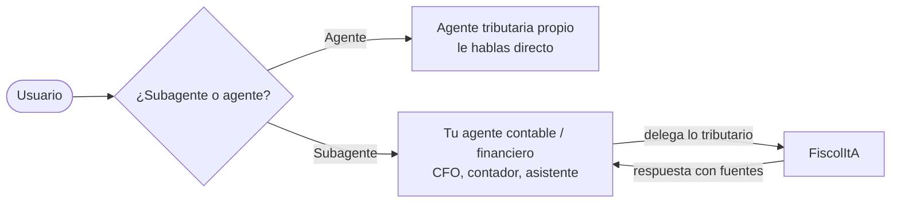

<p align="center">
  
</p>

<p align="center">
  <a href="https://fiscolita.optimizaria.com"><b>fiscolita.optimizaria.com</b></a><br><br>
  <b>Agente de IA tributario para el SII de Chile: la IA que sabe todo lo público del Servicio de Impuestos Internos.</b><br>
  Pregúntale por IVA, Renta, F29, boletas, facturas o plazos, y te responde con la fuente oficial al lado.
</p>

<p align="center">
  <a href="TUTORIAL.md"></a>
</p>

<p align="center">
  
  
  
  
  
  
  
</p>

---

## ¿Qué es?

Fiscol**I**t**A** es una agente tributaria para cualquier asistente de IA que lea `AGENTS.md` (Claude Code, Codex, Cursor, Gemini CLI y otros). Trae dentro una copia completa y buscable de la información pública del SII y responde:

- **qué dice la norma**: leyes vigentes, circulares, resoluciones y oficios;
- **cómo se hace el trámite**: menú de sii.cl, formulario, código y plazo;
- **cuánto es en pesos**: calculadora UF / USD / EUR / UTM con valores del día.

Solo contiene información pública oficial. No trae datos de ninguna persona ni empresa.

### Ejemplos

| Preguntas | Fiscol**I**t**A** responde con |
|---|---|
| ¿Qué código del F29 posterga el pago del IVA? | Código 756, requisitos, plazo y preguntas frecuentes del SII |
| ¿Cuál fue la última circular? | consulta en vivo a sii.cl + resumen + PDF |
| ¿Cómo se completa un F50? | paso a paso del menú Servicios online |
| ¿Cuánto se retiene en una boleta de honorarios en 2026? | 15,25 % + tabla de gradualidad + fuente |
| Calcula 25 UF | UF, USD, EUR y UTM en pesos del día, con fuente y fecha |
| /multa 500000 7 | multa del art. 97 N° 2 (14 %) + interés penal vigente |
| (foto de una notificación) | qué es, qué te piden, plazo y qué hacer |

## Funcionalidades

| | Función | Cómo se usa |
|---|---|---|
| 📚 | **Responde con fuente oficial** y un sello `✅ Fuente oficial SII · fecha` (o `⚠️ Modificada por …` si la norma cambió) | pregunta normal |
| 🔄 | **Siempre al día**: cada día agrega sola las circulares, resoluciones y oficios nuevos | automático |
| 🧮 | **Simuladores** en pesos: retención de boleta de honorarios, bruto para un líquido, PPM, IVA, multa e interés por atraso, impuesto único de un sueldo | `/bhe`, `/liquido`, `/ppm`, `/iva`, `/multa`, `/sueldo` · `python3 simuladores.py` |
| 📅 | **Calendario tributario**: F29/F50, F22, contribuciones, DJ y cambio de UF, con días hábiles | `/calendario` · `python3 calendario.py` |
| 🔔 | **Alertas diarias** por Telegram: vencimientos (3 días antes, el día anterior y el mismo día) + normas nuevas del SII | `/alertas` (`/alertas off` para dejar) |
| 📰 | **Resumen de novedades** del día | `/novedades` |
| 📷 | **Lee fotos y PDF**: factura, notificación o carta del SII → qué es, qué te piden, plazo y qué hacer | enviar foto o documento al bot |
| 🎙️ | **Notas de voz**: transcribe y responde | enviar audio (requiere `OPENAI_API_KEY`, `GROQ_API_KEY` o `whisper` local) |
| 💱 | **Calculadora** UF / USD / EUR / UTM → pesos del día | enviar un monto (`15`) · `python3 calculadora.py` |
| 🤝 | **Resumen para tu contador**: tu caso, lo encontrado, montos y qué validar, listo para reenviar | `/contador` |
| 🖥️ | **Sitio web** con simuladores, indicadores, calendario y normas del SII en vivo | [fiscolita.optimizaria.com](https://fiscolita.optimizaria.com) · código en [`web/`](web/) |

## Qué sabe

| Fuente | Cobertura |
|---|---|
| www.sii.cl completo | ayudas, servicios online, destacados, factura electrónica, declaraciones juradas, valores y fechas |
| Circulares del SII | 1981 – 2026 |
| Resoluciones del SII | 1978 – 2026, más resoluciones regionales de 2026 |
| Jurisprudencia administrativa | oficios 1998 – 2026 (Renta, IVA, otras normas) |
| Preguntas frecuentes | 3.344 preguntas en 26 temáticas |
| Leyes vigentes (BCN) | Renta, IVA, Código Tributario, Timbres, Impuesto Territorial, Herencias |

Detalle completo en [`INDICE.md`](INDICE.md) y en los catálogos de [`docs/_catalogos/`](docs/_catalogos/).

## Instalación

**¿No eres del área de la tecnología?** Sigue el [tutorial paso a paso](TUTORIAL.md): desde descargar el proyecto e instalar Python hasta conversar con la agente en tu computador o en Telegram, sin conocimientos previos.

```bash
git clone <url-del-repo> fiscolita
cd fiscolita
pip install requests beautifulsoup4 lxml markdownify
```

| Requisito | Para qué |
|---|---|
| Python 3.10+ | buscador, consultas en vivo, calculadora, instalador |
| `pdftotext` (poppler) | leer PDFs del SII en vivo |
| [uv](https://docs.astral.sh/uv/) | ejecutar el servidor MCP (opcional) |

La primera búsqueda construye el índice `busqueda.sqlite` a partir de `docs/` (1 a 2 minutos, una sola vez).

## Modos de uso

Al abrir el proyecto con tu agente por primera vez, Fiscol**I**t**A** pregunta:

1. **¿Quieres trabajar conmigo como subagente o como agente?**
2. **¿Qué nombre me pones?**



### Opción A: como agente propio

Fiscol**I**t**A** queda como la agente tributaria de tu empresa.

```bash
python3 instalar.py --modo agente --nombre "FiscolItA"
```

Después, ábrelo en esta carpeta (`claude`, `codex`…) o desde cualquier carpeta en Claude Code con la skill `/fiscolita`.

### Opción B: integrada a otro agente (subagente)

Tu agente contable o financiero le delega todo lo tributario.

```bash
python3 instalar.py --modo subagente --nombre "FiscolItA" --padre ruta/al/agente_contable.md
```

El instalador agrega al archivo de tu agente principal una sección **"Delegación tributaria"** (y deja una copia `.bak`). Con eso el agente principal sabe cuándo y cómo llamar a Fiscol**I**t**A**.

### Qué crea el instalador

| | Agente | Subagente |
|---|:-:|:-:|
| `config/identidad.json` (nombre y modo) | ✔ | ✔ |
| Claude Code: `~/.claude/agents/<nombre>.md` | ✔ | ✔ |
| Claude Code: skill `~/.claude/skills/<nombre>/` | ✔ | ✔ |
| Sección de delegación en el agente principal | | ✔ |

Opciones: `--sin-claude`, `--sin-skill`. Puedes re-ejecutarlo sin duplicar nada.

### Opción C: solo los scripts (sin agente)

```bash
python3 buscar.py "boleta honorarios retención" -c faq
python3 en_vivo.py circulares -n 3
python3 calculadora.py 25
```

## Cómo está organizado

Fiscol**I**t**A** separa **quién es**, **qué sabe** y **qué recuerda de ti**:

| Capa | Archivos | Se comparte | Descripción |
|---|---|:-:|---|
| **Entrada** | `AGENTS.md`, `CLAUDE.md` | sí | punto de entrada para cualquier agente de IA |
| **Identidad** | [`agente/IDENTIDAD.md`](agente/IDENTIDAD.md) | sí | rol, misión, personalidad y límites |
| **Contexto** | [`agente/CONTEXTO.md`](agente/CONTEXTO.md), `docs/`, `INDICE.md` | sí | conocimiento público del SII y la BCN |
| **Reglas** | [`agente/REGLAS.md`](agente/REGLAS.md) | sí | cómo responde, qué hace siempre y qué no hace nunca |
| **Arranque** | [`agente/ARRANQUE.md`](agente/ARRANQUE.md) | sí | preguntas de la primera vez e instalación |
| **Herramientas** | [`agente/HERRAMIENTAS.md`](agente/HERRAMIENTAS.md), `*.py`, `mcp_sii/` | sí | buscador, en vivo, calculadora, MCP |
| **Memoria** | [`agente/MEMORIA.md`](agente/MEMORIA.md) → `memoria/`, `config/` | **no** | tu nombre del agente, modo y perfil tributario, solo en tu equipo |

```
fiscolita/
├── AGENTS.md                 entrada (estándar multi-agente)
├── CLAUDE.md                 entrada para Claude Code
├── agente/                   IDENTIDAD · CONTEXTO · MEMORIA · ARRANQUE · REGLAS · HERRAMIENTAS
├── docs/                     ~29.700 documentos en Markdown (+ _catalogos/, leyes_vigentes/)
├── INDICE.md                 índice de la información
├── buscar.py                 búsqueda de texto completo
├── construir_indice.py       genera busqueda.sqlite (automático)
├── en_vivo.py                consultas del día a sii.cl
├── calculadora.py            UF / USD / EUR / UTM → pesos
├── simuladores.py            BHE, PPM, IVA, multas, impuesto de un sueldo
├── calendario.py             vencimientos tributarios
├── actualizar_novedades.py   revisión diaria automática de normas nuevas
├── telegram/                 bot de Telegram (bot.py, README, requirements)
├── web/                      sitio fiscolita.optimizaria.com (Vercel)
├── assets/                   logo, mascota, demo animada
├── .env.example              plantilla de variables del bot (.env no se versiona)
├── instalar.py               agente o subagente
├── mcp_sii/server.py         servidor MCP
├── _tools/                   regenerar la base desde sii.cl
├── memoria/                  (privado, no se versiona)
└── config/                   (privado, no se versiona)
```

## MCP

`.mcp.json` registra el servidor `asesor-tributario-sii`. Claude Code lo activa al abrir la carpeta. En otros clientes:

```bash
uv run --python 3.12 --with "mcp<2" --with requests --with beautifulsoup4 \
  --with lxml --with markdownify python mcp_sii/server.py
```

| Tool | Descripción |
|---|---|
| `buscar` / `leer_documento` | base local |
| `ultimas_normas` | últimas circulares, resoluciones u oficios |
| `valor_indicador` | UTM, UF o dólar del año |
| `pagina_sii` | cualquier página o PDF público de sii.cl |
| `calculadora` | UF / USD / EUR / UTM → pesos |
| `simulador` / `calendario` | simuladores en pesos y próximos vencimientos |
| `sii_login` / `sii_consultar` | tu cuenta SII, **solo lectura** |

### Conectar tu cuenta del SII (opcional)

El SII no tiene un MCP oficial. `sii_login` entra con tu RUT y clave tributaria, y `sii_consultar` **solo lee**: bloquea declarar, rectificar, anular, pagar, firmar y timbrar.

**La clave nunca se escribe en el chat.**

| Sistema | Cómo guardar la credencial |
|---|---|
| macOS | `security add-generic-password -s asesor-sii -a 12345678-9 -w` (la pide oculta) |
| Linux / Windows | variables `ASESOR_SII_RUT` y `ASESOR_SII_CLAVE` en el entorno del servidor MCP |

Úsalo solo con tu propia cuenta o con autorización del titular.

## Bot de Telegram

**⚠️ El bot corre en tu computador o servidor, no en Telegram: ese equipo debe estar encendido, sin suspenderse y con internet todo el tiempo.** Si se apaga, el bot deja de responder y no envía las alertas.

<p align="center"></p>

Usa Fiscol**I**t**A** desde el celular. Funciona **siempre que cuentes con un motor de IA**: una suscripción, una API key o un modelo local.

| Tipo | Motor (`FISCOLITA_BACKEND`) | Necesitas | Lee fotos |
|---|---|---|:-:|
| Suscripción | `claude` | plan Claude Pro/Max + [Claude Code](https://claude.com/claude-code) con sesión iniciada | ✔ |
| Suscripción | `codex` | plan ChatGPT Plus/Pro + [Codex CLI](https://github.com/openai/codex) con sesión iniciada | PDF |
| CLI | `gemini-cli` | [Gemini CLI](https://github.com/google-gemini/gemini-cli) con `GEMINI_API_KEY` o cuenta Workspace / Vertex AI (el inicio de sesión con cuenta Google personal ya no está disponible) | PDF |
| API (pago por uso) | `anthropic` | `ANTHROPIC_API_KEY` | ✔ |
| API (pago por uso) | `openai` | `OPENAI_API_KEY` + `FISCOLITA_MODEL` | ✔ |
| API (pago por uso) | `gemini` | `GEMINI_API_KEY` (Google AI Studio) + `FISCOLITA_MODEL` | ✔ |
| API (pago por uso) | `openrouter` | `OPENROUTER_API_KEY` + `FISCOLITA_MODEL` (cientos de modelos) | según modelo |
| Local y gratis | `ollama` | [Ollama](https://ollama.com) en el equipo + `FISCOLITA_MODEL` | según modelo |
| Local y gratis | `lmstudio` | [LM Studio](https://lmstudio.ai) con el servidor local encendido | según modelo |
| Local y gratis | `llamacpp` · `jan` · `localai` · `vllm` · `gpt4all` · `koboldcpp` | el servidor local de cada uno ([llama.cpp](https://github.com/ggml-org/llama.cpp), [Jan](https://jan.ai), [LocalAI](https://localai.io), [vLLM](https://docs.vllm.ai), [GPT4All](https://gpt4all.io), [KoboldCpp](https://github.com/LostRuins/koboldcpp)) | según modelo |
| Local y gratis | `local` | cualquier otro servidor compatible con OpenAI, con `FISCOLITA_BASE_URL` | según modelo |

Con los motores de API, los locales y `claude`, la agente usa sus herramientas (búsqueda, lectura de documentos, simuladores, calendario, consultas en vivo). Con `codex` y `gemini-cli`, el bot busca primero en la base local y le entrega los documentos al modelo.

Resumen del paso a paso (detalle completo en [`telegram/README.md`](telegram/README.md)):

1. En Telegram abre **@BotFather** → `/newbot` → nombre (`FiscolItA`) → usuario terminado en `bot` → copia el **token**.
2. `cp .env.example .env` y completa `TELEGRAM_BOT_TOKEN`, `FISCOLITA_BACKEND` y la clave o modelo de tu motor (tabla de arriba).
3. Ejecuta:
   ```bash
   uv run --python 3.12 --with-requirements telegram/requirements.txt python telegram/bot.py
   ```
4. Escríbele `/id` a tu bot, pon ese número en `TELEGRAM_ALLOWED_USERS` del `.env` y reinicia el bot.
5. Pregunta lo que quieras, envía fotos, PDF o notas de voz, y activa `/alertas` para recibir avisos cada mañana.

`.env` está en `.gitignore` y nunca se sube. El bot rechaza a cualquier usuario que no esté en `TELEGRAM_ALLOWED_USERS` y no usa las herramientas con credenciales del SII.

## Sitio web

[fiscolita.optimizaria.com](https://fiscolita.optimizaria.com) es un sitio estático con una función serverless, desplegado en Vercel desde la carpeta `web/`:

- simuladores (boleta de honorarios, PPM, IVA, multa por atraso, impuesto de un sueldo, calculadora) que corren en el navegador;
- UF, UTM, dólar y euro del día (mindicador.cl);
- próximos vencimientos con días hábiles;
- últimas circulares, resoluciones y oficios consultados en vivo en www.sii.cl (`web/api/novedades.js`, caché de 6 horas).

Además, una página por calculadora (`/calculadora-boleta-honorarios`, `/calculadora-iva`, `/calendario-tributario`…) con explicación, preguntas frecuentes y datos estructurados, más `sitemap.xml`, `robots.txt`, `llms.txt` y `security.txt`. Se generan desde `web/index.html` con:

```bash
python3 _tools/gen_web.py      # regenera páginas, sitemap y archivos SEO
cd web && vercel deploy --prod
```

## Actualización diaria automática

Regla general: **la primera consulta de cada día** (desde la terminal, el MCP o Telegram) revisa en www.sii.cl las circulares, resoluciones y oficios del año, descarga los nuevos, los convierte a texto y los agrega al índice. Las demás consultas del día no vuelven a revisar.

```bash
python3 actualizar_novedades.py --forzar   # revisar ahora
FISCOLITA_SIN_ACTUALIZAR=1                 # desactivar
```

Sin conexión no hace nada y la consulta sigue con la base local. El registro de lo agregado queda en `config/actualizacion.json`.

## Actualizar la base

Regeneración completa (la diaria es automática):

```bash
python3 -I _tools/crawler.py "$PWD"     # descarga sii.cl (reanudable)
python3 -I _tools/oficios.py "$PWD"     # jurisprudencia administrativa
python3 -I _tools/convertir.py "$PWD"   # HTML/PDF/DOC → Markdown + índice
python3 -I _tools/leyes.py "$PWD"       # leyes vigentes desde BCN
python3 -I _tools/gen_indice.py "$PWD"  # catálogos
```

## Aviso

Fiscol**I**t**A** orienta a partir de información pública oficial. **No es el SII ni habla en su nombre** y no reemplaza la asesoría de un contador o abogado tributario. Las normas cambian: verifica la vigencia en [sii.cl](https://www.sii.cl).
